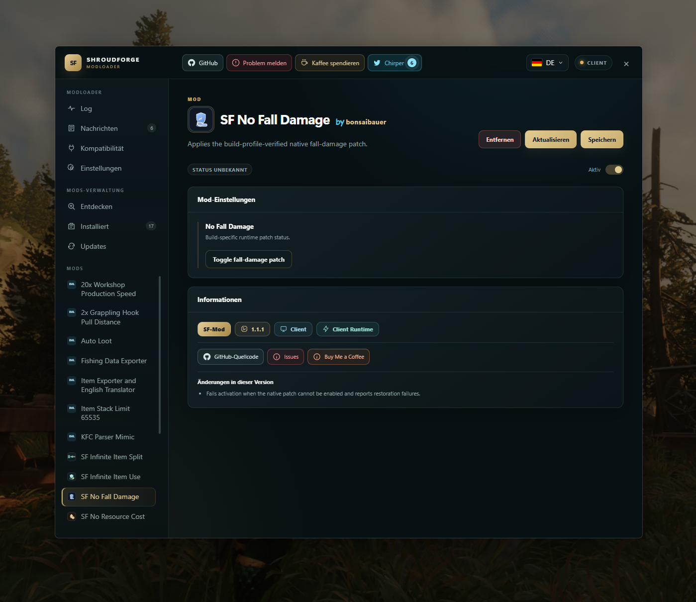
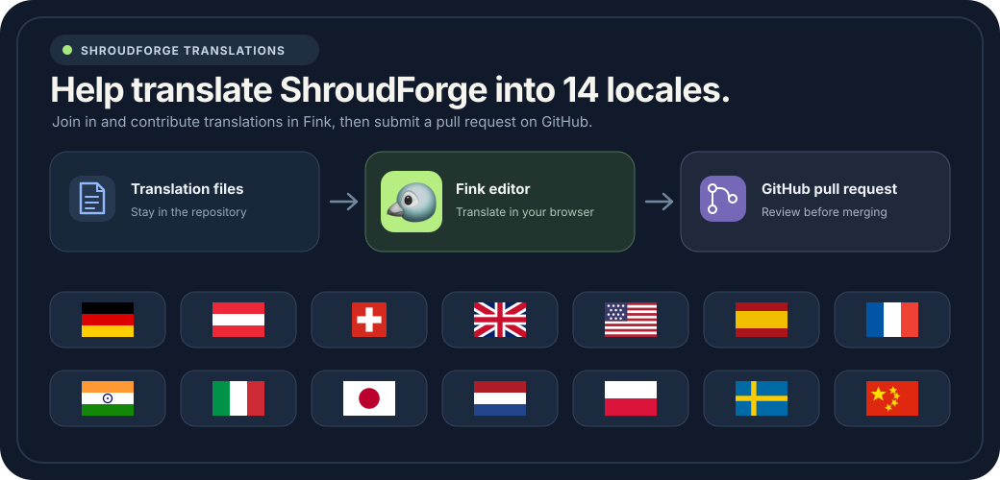

# ShroudForge

[](https://github.com/bonsaibauer)
[](https://github.com/bonsaibauer/shroudforge)
[](https://github.com/bonsaibauer/shroudforge/blob/main/LICENSE)
[](https://github.com/bonsaibauer/shroudforge)
[](https://github.com/bonsaibauer/shroudforge/releases)
[](https://github.com/bonsaibauer/shroudforge)


[](https://github.com/bonsaibauer/shroudforge/issues/new?template=bug_report.yml)
[](https://github.com/bonsaibauer/shroudforge/issues/new?template=feature_request.yml)
[](https://github.com/bonsaibauer/shroudforge/issues/new?template=version_mismatch.yml)


## Welcome!

ShroudForge is the loader that finds, checks, and starts mods for **Enshrouded**. A mod is a separate add-on that changes or adds something in the game. You can use mods made by other players, or create your own. Read [how ShroudForge works](https://bonsaibauer.github.io/shroudforge/en/#workings) for a clear explanation of how the loader and mods fit together.

New to mods? Start with the illustrated guide. It explains everything in simple steps, in English and German:

- [English: install ShroudForge, add mods, and make your first mod](https://bonsaibauer.github.io/shroudforge/en/)
- [Deutsch: ShroudForge einrichten, Mods hinzufügen und den ersten Mod bauen](https://bonsaibauer.github.io/shroudforge/de/)

The guide includes separate instructions for your PC and game server, pictures of the Modloader, a first-mod lesson, and an interactive preview for mod settings.

<p align="center">
  <a href="https://github.com/bonsaibauer/shroudforge/releases/latest"></a>
</p>

<p align="center">
  <a href="https://github.com/bonsaibauer/shroudforge/releases/latest"></a>
</p>

<p align="center">
  <a href="https://github.com/bonsaibauer/shroudforge?tab=security-ov-file"></a>
</p>

<p align="center">
  <a href="https://www.youtube.com/watch?v=V57iZcn-hfo"></a>
</p>



## Quickstart: use ShroudForge

1. Close Enshrouded.
2. Download the Latest release:
   
   [](https://github.com/bonsaibauer/shroudforge/releases/latest) [](https://github.com/bonsaibauer/shroudforge/releases)
   
3. Right-click the downloaded ZIP and choose **Extract All**.
4. Open the Enshrouded folder that contains **enshrouded.exe**.
5. Copy the files from the ZIP into that folder, beside **enshrouded.exe**.
6. Start Enshrouded and press **F9** to open the Modloader.

A common Steam folder is:

~~~text
C:\Program Files (x86)\Steam\steamapps\common\Enshrouded
~~~

The Modloader is the ShroudForge window inside the game. It shows your mods and lets you switch them on or off. Press **F10** to read messages if something does not work.

### Add a mod

Follow the mod creator's instructions. Unpack the mod download, then copy the mod folder into **mods**, beside **enshrouded.exe**. Keep any folder structure and extra files the creator includes.

Open the game, press **F9**, find the mod, and switch it on. Some mods need a game restart. Mods that change game files must prepare those changes before the game starts.

Read the full [PC quickstart](https://bonsaibauer.github.io/shroudforge/en/#play) for screenshots and help with each step.

## Multiplayer server quickstart

> [!NOTE]
> The extra environment setting below is only for the Proton Docker image. It is not needed for the Windows game or the Enshrouded Dedicated Server installed through Steam.

Install ShroudForge and the mod on your PC and on the server.

1. Stop the server and back up your world.
2. Download the [latest ShroudForge release](https://github.com/bonsaibauer/shroudforge/releases/latest).
3. Right-click the ZIP file and choose **Extract All**.
4. Open the server folder containing **enshrouded_server.exe**.
5. Copy the ShroudForge files from the ZIP into that folder, beside **enshrouded_server.exe**.
6. Unpack the mod you want to use, then copy its folder into the server's **mods** folder.
7. If you use the Proton Docker image [`mornedhels/enshrouded-server`](https://github.com/mornedhels/enshrouded-server), add the environment setting below. It lets Proton load ShroudForge's DLLs.

   For an existing `docker run` setup, add this option to its command:

   ```bash
   -e 'WINEDLLOVERRIDES=dbghelp=native,builtin;winmm=native,builtin' \
   ```

   For Docker Compose, add the setting under `environment`, as shown in this complete example:

   ```yaml
   services:
     enshrouded:
       image: mornedhels/enshrouded-server:dev-proton
       restart: unless-stopped
       ports:
         - "15637:15637/udp"
       volumes:
         - ./gamefiles:/opt/enshrouded
       environment:
         - "WINEDLLOVERRIDES=dbghelp=native,builtin;winmm=native,builtin"
   ```

   Keep your existing image, ports, volume, and other settings. After changing the environment, recreate the Docker container. The normal server port is **15637/udp**.

8. Start the server again.

See the [English server guide](https://bonsaibauer.github.io/shroudforge/en/#server) or the [German server guide](https://bonsaibauer.github.io/shroudforge/de/#server) for the full Docker steps, including how to find and inspect an existing container before recreating it.

## Make your first mod

Start with the [mod template](docs/modding/starter-mod/README.md). It gives you the files for a small mod and explains what to change.

The website's [first-mod lesson](https://bonsaibauer.github.io/shroudforge/en/#first) walks through a complete example. When you are ready, try the [mod settings guide](https://bonsaibauer.github.io/shroudforge/en/#manifests): edit an example on the left and see the Modloader-style preview on the right. It also shows how `extended.mod.json` exposes a setting and how Lua reads it with `shroudforge.settings.get`.

To look up functions or Enshrouded game information, open the [searchable API reference](https://bonsaibauer.github.io/shroudforge/en/#api).


## Contribute translations

Help bring ShroudForge to players worldwide by contributing translations in Fink. Submit your changes as a GitHub pull request. Read the [translation guide](modules/wiki/articles/translations/en.md) for the steps.

[](https://fink.inlang.com/?repo=bonsaibauer/shroudforge&project=modules/ui-resources/project.inlang)

## Repository structure

Product code is grouped by responsibility under `modules/`. Each module owns its behavior and its UI where needed. The [module guide](modules/README.md) and [code ownership guide](docs/development/code-ownership.en.md) describe the current boundaries.

~~~text
modules/
  entrypoints/loader/       # Loader application and startup entrypoints
  modloader/                # Find, validate, configure, and order mods
  mod-runtime/              # Prepare and run mods, Lua APIs, callbacks, and reloads
  game-files/               # Game-file backups, status, and asset transactions
  game-runtime/             # Native game access, Rust bridge, compatibility, and profiles
  runtime-diagnostics/      # Runtime diagnostic jobs and measurements
  updater/                  # System updates and mod package updates
  transport/                # Steam networking
  world-editor/             # World editing features
  commands/                 # Command-line actions
  debug-console/            # In-game log and diagnostics window
  loader-config/            # Loader settings and game paths
  logging/                  # Log writing and display
  notifications/            # News events and notifications
  ui-resources/             # Shared UI resources and translations
.github/                    # GitHub workflows
dev/                        # Build actions, parser setup, tests, and profile tools
docs/                       # Guides, examples, evidence, and website source
website/                    # Static download website for shroudforge.net
mods/                       # Mod source included with the repository
kfc-parser/                 # Direct Git submodule for the KFC parser
assets/                     # Repository images and branding
build/                      # Generated build and website output
target/                     # Cargo build output
~~~

The `modules/game-runtime/` directory contains the native runtime and its Rust bridge. `modules/mod-runtime/` runs ShroudForge mods through that bridge. The actual mod source lives under `mods/`.

## License and support

ShroudForge is shared under the [MIT License](https://github.com/bonsaibauer/shroudforge/blob/main/LICENSE).

# Buy Me A Coffee

If this project has helped you in any way, do buy me a coffee so I can continue to build more of such projects in the future and share them with the community!

<a href="https://buymeacoffee.com/bonsaibauer" target="_blank"></a>
