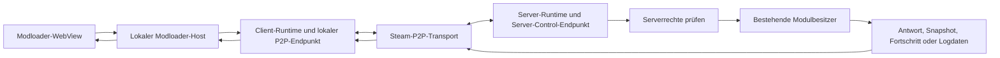

# Masterplan: Serveransicht im Modloader-Client

**Status:** Architekturvorschlag auf Basis einer gezielten Code- und Live-Server-Prüfung  
**Ziel:** Den bestehenden Modloader im Client um eine geschützte Ansicht für einen Dedicated Server erweitern. Seiten und Bedienelemente bleiben vertraut. Daten und Aktionen kommen für das Serverziel vom Server.

## 1. Zielbild

Der Modloader bleibt ein gemeinsames Fenster mit derselben Navigation. Oben wählt man **Client** oder **Server**. Die aktuelle Seite, etwa Aktivität, installierte Mods oder Kompatibilität, zeigt danach die Daten des gewählten Ziels. Serverlogs erhalten zusätzlich eine eigene Client-/Server-Umschaltung in der Debug Console.

Der Dedicated Server startet weiterhin ohne interaktives Fenster. Er stellt dem Client eine schmale, typisierte Verwaltungsoberfläche über den bestehenden Steam-P2P-Transport bereit. Der Client sendet keine beliebigen Datei-, Shell- oder Lua-Befehle. Der Server prüft jede Anfrage und ruft danach die vorhandene Funktion des zuständigen Moduls auf.

**Erste Produktgrenze:** Zunächst ist ein über die vorhandene `serverSteamId` konfigurierter Server das Remote-Ziel. Mehrere gespeicherte Serverprofile können später ergänzt werden, falls der Betrieb das benötigt.

## 2. Geprüfter Ist-Zustand

### 2.1 Modloader-Oberfläche

Die Navigation des Modloaders hat die Bereiche Aktivität, News, Kompatibilität, Einstellungen, Wiki, Entdecken, Installiert, Updates und Papierkorb. Installierte Mods erzeugen darunter dynamische Detailseiten. Diese Oberfläche ist bereits eine gemeinsame Shell aus [app.tsx](../../modules/modloader/ui/app.tsx) und [show-page.tsx](../../modules/modloader/ui/show-page.tsx).

Das UI spricht seinen nativen Host über typisierte WebView-Nachrichten an. Der Host liest einen `Snapshot`, verarbeitet Befehle und fragt Daten periodisch neu ab. [ui-snapshot.ts](../../modules/modloader/ui/ui-snapshot.ts) kennt bereits `CLIENT`, `SERVER` und `DESKTOP`. Der Servermodus bedeutet heute aber einen lokalen Host mit Serverinstallation. Ein Remote-Snapshot im Client existiert noch nicht.

### 2.2 Dedicated Server und Debug Console

Der [Windows-Bootstrap](../../modules/entrypoints/windows-bootstrap/module_processes.cpp) überspringt auf dem Dedicated Server sowohl das Modloader-Fenster als auch die interaktive Debug Console. Der Server schreibt stattdessen in `shroudforge-server.log`. Der heutige Debug-Console-Host liest lokal `enshrouded.log` und das lokale ShroudForge-Clientlog. Für einen entfernten Server muss das Log daher im Serverprozess gelesen und kontrolliert über P2P übertragen werden.

### 2.3 Vorhandener Steam-P2P-Transport

[modules/transport/](../../modules/transport/) verwendet die Steam-Networking-Schnittstellen, die Enshrouded bereits initialisiert. Der Modloader soll keinen zweiten Steam-Callback-Pump starten. Der native Transport begrenzt einzelne Nachrichten auf 512 KiB. Kanal 65535 ist für Netzwerk-Healthchecks reserviert. Lua-Modnachrichten benötigen eine Runtime-Capability. Das Feld `from_mod` ist ein Routingwert und kein Nachweis für eine vertrauenswürdige Identität.

Auf dem Dedicated Server stammen verbundene Peer-IDs aus der von Enshrouded authentifizierten Spielerliste. Die optionale `modules.network.allowedClientSteamIds`-Liste wird zusätzlich angewandt. Eine nichtleere, ungültige Allowlist wird restriktiv behandelt. Diese Liste regelt den Netzwerkzugang. Sie ist kein Beleg für ein Modloader-Administratorrecht.

Das [World-Editor-P2P](../../mods/world-editor/src/p2p.lua) ist ein bestehendes Beispiel für sichere Fachdatenübertragung. Es verwendet begrenzte, geordnete Chunks mit Prüfsumme, Anfragestatus, Duplikatbehandlung und bestätigten Ergebnissen. Die Serveraktion geht danach durch die kanonische World-Editor-Implementierung in [operations.lua](../../mods/world-editor/src/operations.lua). Für Modloader-Verwaltung wird ein eigener, typisierter Befehlssatz benötigt.

### 2.4 Live-Server und Spielerrechte

Am 3. November 2026 liefen auf dem Entwicklungsrechner sowohl Enshrouded-Client als auch Dedicated Server. Die installierte Serverkonfiguration enthält die Gruppen Admin, Friend, Guest und Visitor mit unterschiedlichen Werten für `canKickBan`, `canAccessInventories`, `canEditWorld`, `canEditBase` und `canExtendBase`. Die Zugangspasswörter wurden bei der Prüfung nicht ausgegeben und gehören niemals in einen Remote-Snapshot.

Du hattest auch mit dem Serverlog recht. Das aktive `logs/enshrouded_server.log` protokolliert beim Beitritt die effektiven Spielerrechte. Im gerade geprüften Eintrag standen `CanKickBan`, `CanAccessInventories`, `CanEditBase`, `CanEditWorld` und `CanExtendBase`. Damit haben wir einen Live-Nachweis für die Rechte, die Enshrouded dem Spieler tatsächlich gegeben hat.

Der Beitrittslog ordnet diese Rechte einem Spielernamen zu. Der aktuell verwendete ShroudForge-Transport liefert separat authentifizierte SteamIDs. Der Modloader hat noch keine geprüfte Funktion, die beides im Serverprozess sicher zusammenführt. Die generierten Enshrouded-Typdaten führen `keen::PlayerPermissions` als Bitmaske. Eine freigegebene Runtime-Operation für die Live-Abfrage dieser Rechte ist in der aktuellen ShroudForge-Lua-API nicht vorhanden.

Der Spielername ist damit eine Anzeigeinformation. Der Logeintrag allein reicht nicht aus, um die Steam-P2P-Verbindung einer Rechtezeile zuzuordnen, weil er keine SteamID enthält. Ein vom Client gesendeter Name darf diese Zuordnung nicht ersetzen.

Der laufende ShroudForge-Server hat Steam-P2P-Healthchecks bestätigt und protokolliert World-Editor-Anfragen. Das aktuelle ShroudForge-Log beschreibt die bestehende World-Editor-Zulassung über verbundene Enshrouded-Spieler und die Network-Beschränkung. Die effektiven Enshrouded-Rechte fließen dort noch nicht in die Freigabe ein.

Die Serverinstallation hat aktuell Netzwerk-P2P aktiviert und eine Allowlist mit einem Eintrag. Der Eintrag selbst wird hier nicht dokumentiert. Diese Prüfung betrifft nur den aktuellen lokalen Entwicklungsserver. Ein Produktionsserver kann eine andere Konfiguration haben.

## 3. Rechte-Modell

Die Implementierung braucht getrennte Freigaben für Spielaktionen und ShroudForge-Verwaltung. In der ersten Ausbaustufe leitet der Serververwaltungszugang `CanKickBan` aus den effektiven Enshrouded-Rechten ab. Weltaktionen prüfen ihre passenden Enshrouded-Rechte zusätzlich.

### 3.1 Enshrouded-Spielrechte

Enshrouded weist einem verbundenen Spieler effektive Rechte wie `CanEditWorld` oder `CanKickBan` zu. Der Server muss den Steam-Peer aus dem Transport mit dem aktuellen Enshrouded-Spielerzustand und dessen Rechten verbinden. Die Zuordnung gilt für die aktive Sitzung und wird bei Aktionen erneut geprüft. Ein beim Login gecachter Anzeigename oder eine einmalige UI-Prüfung reicht nicht.

Vor der Freigabe dieser Integration wird eine Runtime-Untersuchung benötigt, die für denselben verbundenen Spieler belastbar nachweist:

1. SteamID64 aus der authentifizierten Serververbindung.
2. Enshrouded-Spieleridentität und effektive `PlayerPermissions`-Bitmaske.
3. Korrekte Zuordnung über Beitritt, Trennung und erneuten Beitritt.
4. Übereinstimmung mit der Ausgabe des echten Serverlogs für mehrere Gruppen.

Das Log ist dabei ein guter Vergleichsnachweis. Der Produktpfad sollte die strukturierte Live-Spielerberechtigung lesen. Ein freier Logtextparser wäre für die Autorisierung zu zerbrechlich und besitzt in der gelesenen Zeile keine SteamID. Wenn der Server die SteamID nicht sicher einem aktiven Spielerobjekt mit Rechtemaske zuordnen kann, lehnt er die Verwaltungsanfrage ab.

### 3.2 Empfohlene Freigabe des Modloader-Serverbereichs

Auf der geprüften Serverkonfiguration besitzt nur die Gruppe Admin `canKickBan`. Der Live-Serverlog bestätigt diese effektive Berechtigung beim aktuellen Admin-Spieler. Deshalb ist `CanKickBan` der naheliegende serverseitige Zugangsschlüssel für den Modloader-Serverbereich.

Empfohlene erste Zuordnung:

| Effektives Enshrouded-Recht | Modloader-Freigabe |
| --- | --- |
| `CanKickBan` | Serverbereich öffnen und Serverstatus, Mods, Logs, Settings, Diagnostik und Updateaktionen verwalten |
| `CanEditWorld` | World-Editor-Aktionen prüfen, die die Welt verändern |
| `CanEditBase` | World-Editor-Aktionen prüfen, die den jeweiligen Basenbereich betreffen |
| `CanExtendBase` | World-Editor-Aktionen prüfen, die eine Basengrenze erweitern |
| `CanAccessInventories` | Für künftige Modloader-Funktionen mit Inventarzugriff prüfen |

Die genaue Enshrouded-Rechtekombination für jede World-Editor-Operation wird anhand der originalen Serverprüfung belegt. `CanKickBan` verleiht keine Weltberechtigung. Ein Spieler ohne `CanKickBan` erhält im ersten Ausbau keinen Modloader-Server-Snapshot und kann keine Serververwaltungsaktionen auslösen. Der Server prüft das effektive Recht für jede Anfrage erneut.

Ein Namenswechsel darf keinerlei Rechte ändern. Ändert ein anderer Account seinen Steam- oder Enshrouded-Anzeigenamen auf den Namen eines Admins, bleibt seine SteamID gleich und der Server liest weiter seine eigenen effektiven Rechte. Ohne `CanKickBan` wird der Zugriff abgelehnt. Der Client darf einen Spielernamen als unverbindlichen Anzeigetext mitsenden. Der Server verwendet für die Berechtigung nur die Steam-Peeridentität und die serverseitig zugeordnete Rechtebitmaske.

Eine getrennte SteamID-Rollenliste ist eine optionale Erweiterung für Serverbetreiber, die den Modloader auch ohne aktive Enshrouded-Spielersitzung verwalten müssen. Der aktuelle Transport lässt nur authentifizierte verbundene Spielpeers zu. Deshalb benötigt dieser erste P2P-Ausbau eine aktive Verbindung des berechtigten Spielers. `allowedClientSteamIds` kann diese Verbindung zusätzlich begrenzen, vergibt selbst aber kein Verwaltungsrecht.

### 3.3 Durchsetzung

Die UI blendet nicht verfügbare Aktionen passend aus und zeigt die fehlende Berechtigung. Das ist Bedienhilfe. Die echte Entscheidung fällt ausschließlich im Serverprozess.

Jede Anfrage enthält eine Aktionskennung und Anfragennummer. Der Server bezieht die Absender-SteamID aus Steam. Eine Payload-SteamID oder ein Payload-Spielername wird ignoriert. Der Server prüft die verbundene Enshrouded-Sitzung und die aktuellen effektiven Rechte. Die Prüfung läuft beim Empfang und unmittelbar vor der Ausführung. Rechteentzug und Spielerverbindung werden zeitnah berücksichtigt.

Client- und Serverlog erhalten dieselbe Request-ID. Der Client protokolliert Ziel, Aktion, serverbestätigten Spielernamen und Ergebnis. Der Server protokolliert die authentifizierte Peeridentität, den daraus ermittelten Enshrouded-Spielernamen, die effektiven Rechte, die Entscheidung und das Ausführungsergebnis. Roh-IDs erscheinen nur in einem für Administratoren zugänglichen Log. Damit lässt sich ein Vorgang auf beiden Seiten nachvollziehen, ohne dem Clientnamen zu vertrauen.

## 4. Funktionsmatrix

| Modloader-Funktion | Serveransicht | Schreib- oder Aktionsrecht |
| --- | --- | --- |
| **Zielumschalter** | Client oder konfigurierter Dedicated Server. Zeigt Zielname, Steam-Verbindung, Server-Runtime, ShroudForge-Version und letzten Snapshot-Zeitpunkt. | Auswahl ist lokal. Serververbindung selbst gewährt kein Recht. |
| **Aktivität** | Zeigt die Aktivitäten des gewählten Ziels. Servereinträge erhalten Ziel- und Zeitmarkierung. | `CanKickBan` für Serveraktivität. Kopieren exportiert nur die sichtbaren Einträge. |
| **News und Benachrichtigungen** | Globale News bleiben gemeinsame Katalogdaten. Modbenachrichtigungen und Gelesenstatus können pro Ziel geladen werden. | Globale News bleiben öffentlich. Serverbezogene Modbenachrichtigungen benötigen `CanKickBan`. |
| **Wiki** | Artikel bleiben gemeinsam und offline verfügbar. Kontextuelle Links können auf die gewählte Zielseite führen. | Kein Remote-Schreibrecht. |
| **Entdecken** | Katalogdaten können clientseitig gesucht werden. Installieren adressiert ausdrücklich das gewählte Ziel und zeigt Serverpaket, Zielplattform und Version. | `CanKickBan` für Installation und Paketänderung. |
| **Installierte Mods** | Serverliste mit Manifest, Aktivierung, Version, Ziel, Laufzeitstatus, Abhängigkeiten und verfügbaren Einstellungen. | `CanKickBan` für Ansicht, Einstellungen und Aktivierung. |
| **Mod-Detailseite** | Bestehende Detailseite wird mit Server-Snapshot gerendert. Paketlinks, Beschreibung, Changelog und Abhängigkeiten bleiben sichtbar. | `CanKickBan` für Einstellungen, Aktualisierung, Modaktionen und Entfernen. Jede Modaktion wird serverseitig geprüft. |
| **Updates** | System- und Modupdatezustand, Warteschlange, Fortschritt, Release-Notizen und Fehler des Servers. | `CanKickBan` für Queue und Installation. Neustart und Prozessverwaltung bleiben beim bestehenden Serverbetrieb. |
| **Papierkorb** | Zeigt den serverseitigen Updater-Papierkorb samt Alter und Wiederherstellungsstatus. | `CanKickBan` für Wiederherstellen und endgültiges Löschen. |
| **Kompatibilität: Mod-Erkennung** | Zeigt serverseitige Paketvalidierung und Konfigurationsfehler. | `CanKickBan`. Ein Refresh bleibt eine begrenzte Serveraktion. |
| **Kompatibilität: DLL-Manager** | Zeigt Kandidaten, Filter, Reihenfolge und Profil des Serverziels. Änderungen können einen Serverneustart erfordern. | `CanKickBan`. Keine DLL-Ausführung durch die UI. Bestehende Freigabe- und Ladeplanregeln bleiben maßgeblich. |
| **Kompatibilität: Hotkeys** | Für den Dedicated Server nicht anwendbar. Client-Hotkeys bleiben lokale Einstellungen. | Nur lokale Clientkonfiguration. |
| **Kompatibilität: Abhängigkeiten** | Berechnet den Plan aus der Serverinstallation und den aktivierten Servermods. | `CanKickBan`. Änderungen führen über bestehende Mod-Einstellungs- oder Paketaktionen. |
| **Kompatibilität: Spiel und Runtime** | Zeigt Serverbuild, Serverprofil, Runtimebereitschaft, Provider und Serverdiagnose. Clientprofil und Serverprofil bleiben unterscheidbar. | `CanKickBan`. Profiländerungen folgen bestehenden Profilregeln. |
| **Einstellungen: Allgemein und Darstellung** | Sprache, Zoom, Animation und Fensterverhalten gehören dem Modloader-Client und bleiben lokal. | Lokal. Keine P2P-Anfrage. |
| **Einstellungen: Module** | Zeigt serverseitige Modulpräferenzen, Logging und Netzwerkstatus. Nur servertaugliche Felder sind editierbar. | `CanKickBan` für freigegebene Felder. Sicherheits- und Transportkonfiguration benötigt zusätzlich eine serverlokale Freigabe. |
| **Einstellungen: Pfade** | Zeigt normalisierte Serverpfade mit passenden Labels. Zugangsdaten und private Verzeichnisse werden nicht ungefiltert übertragen. | `CanKickBan`. Erlaubt sind nur vorhandene, validierte Pfadfelder. |
| **Serverkonfiguration** | Kann Servername, Slots und nichtgeheime Rechteprofile aus `enshrouded_server.json` anzeigen. Passwörter, Netzwerkadresse und Bannkonten bleiben verborgen. | `CanKickBan` zum Lesen. Schreibunterstützung braucht Validierung gegen das Spielschema, atomisches Sichern und einen klaren Neustarthinweis. |
| **Runtime-Diagnostik** | Zeigt serverseitige Diagnosestatus und freigegebene Jobdefinitionen. Ergebnisdateien werden begrenzt und gezielt übertragen. | `CanKickBan` für geprüfte Jobs. Schreibende oder weltverändernde Jobs brauchen eine zusätzliche Freigabe und dürfen nicht als allgemeine Diagnose angeboten werden. |
| **Debug Console** | Eigene Umschaltung für Client- und Serverlogs. Serverlogs kommen live oder in begrenzten Blöcken aus dem Serverprozess. | `CanKickBan`. Serverpfade werden nicht gesendet. Sichtbare Logdaten unterliegen der Aufbewahrungsgrenze. |
| **World Editor** | Bestehendes World-Editor-Fenster bleibt der Besitzer seiner Weltaktionen. Die Modloader-Zielauswahl zeigt an, zu welchem Server die P2P-Operation gehört. | Jede Weltaktion prüft die dafür nötigen effektiven Enshrouded-Rechte. `CanKickBan` allein reicht dafür nicht. |

## 5. UI- und Snapshot-Konzept

### 5.1 Gemeinsame Oberfläche

Die bestehende Navigation wird beibehalten. Ein Zielumschalter im Kopfbereich legt einen `TargetContext` fest. Alle Seiten lesen denselben ausgewählten Kontext und erhalten einen Snapshot mit Zielkennung, Zielrolle, Datenzeitpunkt, Verbindungszustand und Berechtigungen.

Jede Ansicht zeigt sichtbar **Client** oder **Server**. Der Server-Snapshot ist eine serverseitig zusammengestellte Produktansicht. Das UI bekommt keine beliebigen Pfade oder die rohe `modloader-config.json`.

Seiten mit nur lokaler Bedeutung, etwa Sprache, Zoom, Hotkeys oder Fenstereinstellungen, zeigen den Clientzustand auch dann als lokal an, wenn der Server ausgewählt ist. Serveränderungen verwenden ausdrücklich den Serverkontext und zeigen bei Neustartbedarf einen Hinweis.

### 5.2 Debug Console

Die Debug Console hat zwei Auswahlachsen:

1. **Ziel:** Client oder Server.
2. **Quelle:** Enshrouded-Log oder ShroudForge-Log.

Der Serverprozess verfolgt seine Dateien mit begrenztem Tail und liefert vollständige neue Logzeilen, Sequenznummer und Cursor. Das UI kann bei Wiederverbindung einen begrenzten neuen Tail laden. Bei Sequenzlücke wird der angezeigte Stand ersetzt, statt Zeilen still zu verlieren. Suche, Schweregradfilter, Pause, Auto-Scroll und Kopieren bleiben UI-seitig.

Übertragen werden Logzeilen, nicht Serverdateipfade. Ein bestätigter Verwaltungsrequest erscheint sowohl im Client- als auch im Serverlog unter derselben Request-ID. Die Serverzeile führt den serverseitig bestätigten Namen und die geprüften Rechte. Logzugriff ist geschützt, weil Logs Spielernamen, Steam-IDs und Betriebsdetails enthalten können.

## 6. Transport und Befehlsfluss

Die WebView sendet einen typisierten Befehl an den vorhandenen Modloader-Host. Der Host prüft die Eingabe und reicht den Befehl an den Client-Runtime-Endpunkt weiter. Der Client-Runtime-Endpunkt verwendet den bestehenden Steam-P2P-Transport. Der Server-Runtime-Endpunkt nimmt den Request an, ermittelt den echten Steam-Absender und führt die Rechteprüfungen aus.

Der Server delegiert anschließend an vorhandene Besitzer:

- Modliste, Manifeste, Settings und Modaktivierung an Modloader und Package-Funktionen.
- Updateprüfung, Warteschlange, Installation und Papierkorb an den Updater.
- Aktivität und Laufzeitlogs an Logging und Debug Console.
- Diagnoseaufträge an Runtime Diagnostics.
- Enshrouded-Spielerrechte an eine erst zu belegende, strukturierte Server-Runtime-Abfrage.
- P2P-Framing, Größenlimits, Sequenzen und Peerzustand an Transport.

Der Transportvertrag wird versioniert. Jeder Befehl hat eine feste Kennung, ein validiertes Payloadschema, eine maximale Größe, Request-ID, Serverinstanzkennung und einen begrenzten Timeout. Lesen, Ergebnis, Fortschritt und Mutation sind unterscheidbare Nachrichtenarten. Serverneustart oder Verbindungsabbruch machen einen gesendeten Schreibauftrag gegebenenfalls **ungewiss**. Das UI wiederholt dann nicht blind.

Für große Logs und Snapshots gelten Obergrenzen für Gesamtdaten, Chunkanzahl, Warteschlange und Zeit. P2P-Erfolg bedeutet zunächst nur, dass Steam die Nachricht angenommen hat. Die UI zeigt Erfolg erst nach der bestätigten Serverantwort und, bei schreibenden Aktionen, dem Rücklesen des resultierenden Zustands.

## 7. Modulgrenzen für die spätere Umsetzung

| Bereich | Zuständigkeit |
| --- | --- |
| `modules/modloader/ui/` | Zielauswahl, gemeinsame Seiten, Berechtigungsanzeige, Serverstatus und Ergebnisdarstellung. |
| `modules/modloader/ui/host/` | WebView-Befehle validieren, lokale Requestzustände verwalten und Remote-Ergebnisse in den vorhandenen Snapshotfluss übergeben. |
| `modules/modloader/` | Typisierte Modloader-Remoteaktionen, Snapshotvertrag und die Zuordnung von `CanKickBan` zur Serververwaltung. Keine beliebigen Dateipfade oder Shellaktionen. |
| `modules/mod-runtime/ingame/` | Nachrichten während der vorhandenen Runtime-Lebensdauer zustellen und die Serverausführung an den richtigen Runtime-Zeitpunkt übergeben. |
| `modules/transport/` | Steam-Nachrichten, P2P-Peers, begrenzte Frames und versionierte Transportregeln. Keine zweite Steam-Callback-Pumpe und keine neue öffentliche Lua-API ohne tatsächlichen Bedarf. |
| `modules/game-runtime/` | Nur wenn die Recherche eine neue native Operation für die strukturierte Abfrage effektiver Enshrouded-Spielrechte begründet. Eine Logzeile allein ist keine native Freigabe. |
| Bestehende Featuremodule | Führen ihre jeweilige Funktion weiter aus. Der Remote-Endpunkt dupliziert keine Installations-, Log-, Diagnose- oder World-Editor-Logik. |

Der Dedicated Server bekommt keinen zweiten UI-Host. Für den Empfang und die Ausführung gibt es einen Laufzeitendpunkt, nicht eine zweite Datei- oder Befehlsinfrastruktur neben den bestehenden Besitzern.

## 8. Umsetzungsphasen

### Phase 0: Spieleridentität und Rechte beweisen

- Mit dem laufenden Server und mehreren Testgruppen die SteamID, Enshrouded-Spieleridentität und effektive Rechte strukturiert erfassen.
- Die Daten mit den Einträgen `logged in with Permissions` im echten Serverlog vergleichen.
- Join, Leave, Rejoin, gleichzeitige Spieler und Rollenwechsel abdecken.
- Ein geprüftes Ergebnis oder eine klare technische Lücke dokumentieren.
- Währenddessen keine Remote-Änderungsbefehle zulassen.

**Abnahme:** Für jede aktive Verbindung ist entweder eine aktuelle, eindeutige SteamID-zu-Rechte-Zuordnung bewiesen oder die Spielrechteintegration bleibt ausgeschaltet. Namen oder Logtext werden nie als Identitätsnachweis verwendet.

Ein zusätzlicher Negativfall ändert den Steam- oder Enshrouded-Anzeigenamen eines Nicht-Admins auf den Namen eines berechtigten Admins. Der Nicht-Admin bleibt gesperrt.

### Phase 1: Verbindung und lesende Serveransicht

- Zielumschalter mit dem einen eingerichteten Server.
- P2P-Handshake, Serveridentität, Runtimeversion und Capability-Snapshot.
- Die serverseitige SteamID-zu-Spieler- und Rechtezuordnung verifizieren und `CanKickBan` bei jeder Anfrage prüfen.
- Lesender Snapshot für Status, Modliste, Abhängigkeiten, Aktivität und Netzwerkzustand.
- Debug Console für Serverlogs mit Limits und Wiederverbindung.

**Abnahme:** Ein verbundener Spieler ohne `CanKickBan` erhält keinen Server-Snapshot und kann keine Serveraktion auslösen. Ein Serverausfall erzeugt einen klaren Offlinezustand.

### Phase 2: Begrenzte Modverwaltung

- Serverseitige Moddetails und Einstellungen lesen.
- Einstellungen speichern und Mods aktivieren oder deaktivieren.
- Serverantwort mit Rücklesewert und Neustartbedarf anzeigen.
- Modaktion nur ausführen, wenn `CanKickBan` vorliegt und die konkrete Aktion serverseitig freigegeben ist.

**Abnahme:** Jeder Schreibbefehl bleibt an Ziel, Steam-Absender, Serverinstanz, Request-ID und Mod-ID gebunden. Veraltete oder doppelte Requests ändern keine zweite Mod.

### Phase 3: Paket- und Updateverwaltung

- Katalog und Updateverfügbarkeit für das Serverziel darstellen.
- Bestehende Queue, Paketvalidierung, Staging, Wiederherstellung und Ergebnisprotokolle serverseitig nutzen.
- Installieren, Aktualisieren und Entfernen mit getrennten Scopes versehen.
- Wartungs- und Neustartbedingungen klar anzeigen.

**Abnahme:** Ein abgebrochener oder unsicherer Auftrag lässt Zustand und Queue nachvollziehbar. Es gibt keine unbestätigte Erfolgsmeldung und keinen blinden Wiederholungsversuch einer Mutation.

### Phase 4: Diagnose, Serverkonfiguration und Wiederherstellung

- Geprüfte Diagnosejobs nach Risiko klassifizieren.
- Nichtgeheime `enshrouded_server.json`-Werte zunächst nur anzeigen.
- Falls Schreibunterstützung benötigt wird, nur konkrete bekannte Felder atomar ändern, Sicherung erzeugen und die erforderliche Serverneustartgrenze respektieren.
- DLL-Auswahl, Papierkorb, Gamefile-Backups und Wiederherstellung mit `CanKickBan` und expliziten Bestätigungen ergänzen.

**Abnahme:** Passwörter und andere Geheimnisse gelangen nie in UI-Snapshots oder Logs. Destruktive Aktionen zeigen Umfang und erwartete Wirkung vor dem Absenden.

### Phase 5: Spielrechte in passende Funktionen integrieren

- Effektive `PlayerPermissions` für World-Editor- und weitere bestehende Spielaktionen verwenden.
- Rechteänderungen während einer Session erneut prüfen.
- `CanKickBan` bleibt die festgelegte Zuordnung für den Modloader-Serverbereich. Die übrigen Spielrechte gelten nur für passend zugeordnete Spielaktionen.

**Abnahme:** Eine Anfrage wird vom Server abgelehnt, wenn die für genau diese Spielaktion erforderliche Enshrouded-Berechtigung fehlt.

## 9. Sicherheits- und Zuverlässigkeitsregeln

1. Steam-Transportidentität ist die Peeridentität. Payloadfelder und `from_mod` sind keine Identitätsquelle.
2. Netzwerk-Allowlist, `CanKickBan` für den Modloader-Serverbereich und die Enshrouded-Spielrechte für Weltaktionen bleiben getrennte Prüfungen.
3. Alle Schreibaktionen werden im Serverprozess autorisiert und vor der Ausführung erneut geprüft.
4. Es gibt keine generische Schreibdatei-, Shell-, DLL-Lade- oder Lua-Eval-Nachricht.
5. Nachrichten, Logs, Warteschlangen, Chunks, Replays und Zeitfenster sind begrenzt.
6. Empfangsbestätigung und abgeschlossene Aktion sind verschiedene Zustände.
7. Nach unklarem Mutationsergebnis wird zuerst Serverzustand gelesen. Die Mutation wird nicht automatisch wiederholt.
8. Serverpasswörter, Netzwerkadresse, Bannkonten und nicht freigegebene IDs werden aus Snapshots entfernt.
9. Berechtigungsentzug oder getrennte Enshrouded-Verbindung sperren neue Aktionen sofort und laufende Aktionen nach der definierten sicheren Abbruchgrenze.
10. Bestehende native Lade-, Update-, Wiederherstellungs- und Welt-Lebenszeitregeln bleiben Eigentum ihrer Module.

## 10. Entscheidungen vor Implementierungsbeginn

1. `CanKickBan` ist die empfohlene Zugangsvoraussetzung für den gesamten Modloader-Serverbereich einschließlich Paketinstallationen, Updates und Wiederherstellungen. Soll es für besonders riskante Aktionen trotzdem eine zusätzliche Serverbestätigung geben?
2. Welche Enshrouded-Rechte verlangen World-Editor-Lesen, Platzieren, Rückgängig und Abbruch jeweils? Diese Zuordnung wird getrennt pro Operation festgelegt.
3. Reicht zunächst ein fest konfigurierter Server, oder wird schon in Version eins eine Liste mehrerer Server benötigt?
4. Welche Modaktionen sind aus der Ferne erlaubt? Paketmetadaten deklarieren die Aktion, aber nicht zwingend ihr Schadenspotenzial.
5. Dürfen `enshrouded_server.json`-Felder später geändert werden, oder bleibt diese Datei in der ersten Ausbaustufe nur lesbar?

Empfehlung: zuerst einen fest konfigurierten Server und `CanKickBan` als serverseitig geprüfte Freigabe für den Modloader-Serverbereich. Die Zuordnung der SteamID zu `PlayerPermissions` wird zuvor strukturiert nachgewiesen. Enshrouded-Weltrechte werden unabhängig davon an passende World-Editor-Aktionen gebunden.

## 11. Geprüfte Quellen und Grenzen

Gezielt geprüft wurden:

- Modloader-Navigation, Snapshot und Seitenrouting in [app.tsx](../../modules/modloader/ui/app.tsx), [show-page.tsx](../../modules/modloader/ui/show-page.tsx) und [ui-snapshot.ts](../../modules/modloader/ui/ui-snapshot.ts).
- Moddetails, Kompatibilität, Einstellungen, Updates und Debug Console in den jeweiligen UI-Modulen.
- UI-Host-Snapshot und lokaler Befehlsfluss in [modules/modloader/ui/host](../../modules/modloader/ui/host/).
- Server-Skip für Modloader- und Debug-Console-Fenster in [module_processes.cpp](../../modules/entrypoints/windows-bootstrap/module_processes.cpp).
- P2P-Vertrag in [modules/transport](../../modules/transport/), [update_ingame_runtime.rs](../../modules/mod-runtime/ingame/update_ingame_runtime.rs) und [modules/mod-runtime/README.md](../../modules/mod-runtime/README.md).
- Vorhandenes World-Editor-P2P in [p2p.lua](../../mods/world-editor/src/p2p.lua) und [operations.lua](../../mods/world-editor/src/operations.lua).
- Die laufende Dedicated-Serverkonfiguration `enshrouded_server.json`, die ShroudForge-Serverkonfiguration und aktuelle Enshrouded- sowie ShroudForge-Logs. Geheimnisse und SteamIDs wurden bei der Ausgabe redigiert.

Das war eine gezielte Architekturprüfung für Modloader, P2P und Serverrechte. Es war kein vollständiges Repository-Audit. Nicht geprüft wurden vollständige Paket-Builds, Release-Paketierung, sämtliche Runtime-APIs und die native Zuordnung von Enshrouded-Spielerhandle zu SteamID und `PlayerPermissions`. Diese Zuordnung ist das wichtigste technische Tor für die Rechteintegration.
