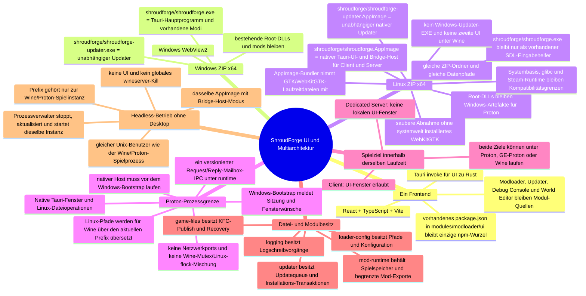

# Tauri 2 für Windows, Linux und Proton: ein Frontend, klare Prozess- und Dateibesitzer

Stand: 15. November 2026. Dies ist ein konkreter Architekturplan, keine behauptete Proton-Freigabe. Er erhält die bestehenden Produktrollen und ZIP-Pfade und ergänzt den fehlenden Linux-/Proton-Prozess- und Schreibvertrag.

## Entscheidung in einem Satz

React, TypeScript und Vite bleiben **ein** Frontend; Tauri 2 hostet dieselben Modul-UIs nativ auf Windows und Linux. Windows und Linux erhalten je ein ZIP. Unter Proton ist die Linux-AppImage der native UI- und Dateihost; die Windows-Spielruntime spricht über **einen begrenzten lokalen Mailbox-IPC-Adapter** mit ihr. Der bestehende unabhängige Updater bleibt ein separater Prozess und erhält pro Hostsystem sein passendes Artefakt.

Das ist kein einzelnes Binärprogramm für alle Betriebssysteme. Windows braucht PE/EXE und Windows-DLLs, Linux native ELF-/AppImage-Ausgaben. Geteilt werden Frontend, Modulbesitz, Rust-Fachlogik, Datenverträge und ZIP-Ordnerlogik; die Hosts werden je Betriebssystem gebaut.

### Die drei Achsen, die getrennt bleiben müssen

`Windows` oder `Linux` bezeichnet das Hostbetriebssystem. `Wine`, Proton oder GE-Proton bezeichnet unter Linux die Laufzeit für die Windows-Spielprozesse. `Client` oder `Dedicated Server` bezeichnet, welches Windows-Spielprogramm in dieser Laufzeit läuft. Im Repository sind das `enshrouded.exe` und `enshrouded_server.exe`; der Bootstrap erkennt diese Rollen anhand des Prozessnamens. Der Server ist damit **kein separates Linux-Ziel und kein eigenes Paket**. Beide Spielrollen verwenden auf Linux dasselbe Linux/Proton-Paket und denselben nativen ShroudForge-Host. Nur die übermittelte Zielrolle und das daraus folgende UI-Verhalten unterscheiden sich.

| Host | Laufzeit des Spiels | Spielziel | ShroudForge-Integration |
| --- | --- | --- | --- |
| Windows | nativ | `enshrouded.exe` oder `enshrouded_server.exe` | Windows-Tauri-Host, Windows-Updater und bestehende Windows-DLL-Injection |
| Linux | Proton, GE-Proton oder Wine | `enshrouded.exe` oder `enshrouded_server.exe` | Linux-Tauri-AppImage als nativer Host, Linux-Updater und dieselben Windows-DLLs im Windows-Spielprozess |

Beim Dedicated Server entfallen die interaktiven Fenster, wie es der aktuelle Bootstrap bereits tut. Ein headless gestarteter Linux-Host ist nur eine **Betriebsart desselben AppImage** für einen Dienstbetrieb ohne Desktop. Er ist weder ein weiteres Spielziel noch ein zusätzlicher Linux-Server-Build.

### Tauri-Entscheidungstor: WebKitGTK im AppImage nachweisen

Tauri nutzt unter Linux WebKitGTK. Die Tauri-AppImage-Ausgabe kann WebKitGTK- und GTK-Laufzeitdateien über den AppImage-Bundler mitnehmen; Tauri beschreibt AppImage als Paket mit den benötigten Abhängigkeiten und der Bundler-Historie sind explizite Fixes für das Einpacken von WebKitGTK dokumentiert. Deshalb ist ein separates `shroudforge/ui/linux/` mit WebKit-Bibliotheken nicht der Vorschlag. [Tauri: AppImage](https://v2.tauri.app/distribute/appimage/), [Tauri Bundler: WebKitGTK im AppImage](https://github.com/tauri-apps/tauri/blob/dev/crates/tauri-bundler/CHANGELOG.md).

Das heißt nicht „läuft auf jedem Linux ohne weitere Voraussetzungen“: AppImage bleibt von der glibc-/Systembasis abhängig, und AppImage/FUSE-, Grafiktreiber-, GTK-/WebKit-Helper- sowie Steam-Runtime-Interaktionen müssen auf den unterstützten Systemen geprüft werden. Die Releaseabnahme muss das konkrete fertige AppImage auf einem System ohne installiertes WebKitGTK testen und prüfen, dass es seine gebündelte Version samt Helpern lädt. Der Tauri-Bundler hatte reale Fehlerfälle bei WebKit-Hilfsdateien und bei übermäßig gebündelten Systembibliotheken; deshalb ist das ein konkreter Paket-Abnahmepunkt, kein bloßes „AppImage erledigt das schon“. [Tauri: WebView-Versionen](https://v2.tauri.app/reference/webview-versions/), [Tauri-Bundler-Fix für WebKitGTK](https://github.com/tauri-apps/tauri/blob/dev/crates/tauri-bundler/CHANGELOG.md), [Tauri AppImage-Laufzeitproblem](https://github.com/tauri-apps/tauri/issues/15665).

## Mindmap



## Was Modrinth als Vorbild liefert

Modrinth trennt einen Tauri-App-Host von einem eigenständigen Frontend-Paket und einer Rust-Fachbibliothek. Das ist das sinnvolle Muster: **Host und Weboberfläche sind getrennte Schichten, Featurelogik gehört in Rust-Module**. ShroudForge muss dafür weder Vue übernehmen noch Modrinths Ein-Fenster- oder Updateaufbau kopieren. ShroudForge hat bereits React/Vite und Modulbesitzer; insbesondere bleibt sein eigener ZIP-Updater maßgeblich. [Modrinth App README](https://github.com/modrinth/code/blob/main/apps/app/README.md), [Tauri-Konfiguration mit separatem Frontend](https://github.com/modrinth/code/blob/main/apps/app/tauri.conf.json).

## Frontend-Struktur ohne zweite npm-/Vite-Landschaft

`modules/modloader/ui/package.json`, `package-lock.json`, `vite.config.ts` und `tsconfig.json` sind heute die einzige npm-/Vite-Wurzel und bauen bereits Modloader und Updater. **Sie bleiben vorerst an diesem Ort**; eine Verschiebung nach `modules/frontend/` bringt keinen nötigen Laufzeitvorteil und würde Buildpfade unnötig anfassen. Tauri-, React-, Vite- und CLI-Versionen werden bei der Umsetzung explizit gepinnt und in den bestehenden Cargo-/npm-Lockfiles festgehalten; für den Desktopbuild wird kein zweiter Paketmanager und kein `latest`-Versionsbezug eingeführt.

Vite wird dort um HTML-Einstiege für Debug Console und World Editor erweitert. Alle Frontend-Einstiege werden in zwei Tauri-Ausgaben gebaut:

```text
build/ui/
  modloader/index.html             # vorhanden
  updater/updater.html             # vorhandener Einstieg
  debug-console/index.html         # ergänzen
  world-editor/index.html          # ergänzen
```

Die vorhandenen Ausgabeordner `build/ui/modloader/` und `build/ui/updater/` bleiben bestehen. Der Loader-Tauri-Host bettet `build/ui/` als Frontendwurzel ein und öffnet je vorhandenem Prozessmodus die passende HTML-Datei; der Updater-Host bettet nur `build/ui/updater/` ein. Es entsteht kein zweiter npm-Build und keine parallele Frontend-Ausgabe.

Der Updater bleibt ein eigener Prozess, darf aber denselben React/Vite-Build und dieselben gemeinsamen UI-Ressourcen nutzen. Quellen bleiben bei den Featurebesitzern:

- Modloader: `modules/modloader/ui/`.
- Updater: `modules/updater/ui/`.
- Debug Console: `modules/debug-console/ui/`; bestehendes HTML/JavaScript wird zu React/TypeScript.
- World Editor: `modules/world-editor/ui/`; bestehendes HTML/JavaScript wird zu React/TypeScript.
- gemeinsame Komponenten, Tokens und Übersetzungen: `modules/ui-resources/`.
- Der Frontend-Adapter für Tauri `invoke`/Events liegt einmalig in `modules/transport/ui/` oder beim bestehenden UI-Transportbesitzer. Steam Networking in `modules/transport/` wird nicht als Desktop-IPC umfunktioniert.

`window.ipc` wird pro UI-Einstieg durch einen Adapter ersetzt, der vorhandene Modulaktionen aufruft. Es gibt keine zweite React-Implementierung der Rust-Aktionen, keinen parallelen Dateisystemdienst und keinen Tauri-FS-Zugriff aus dem Browser. Tauri-Capabilities beschränken die erreichbaren Commands pro Fenster; sie vergeben keine Linux- oder NTFS-Schreibrechte.

Die Umstellung **ersetzt** die bisherigen Tao/WRY-Fensterhosts in Modloader, Updater, Debug Console und World Editor sowie den Frontend-Transport `window.ipc`. Sie behält deren Commandhandler, Snapshot-/Updateverträge, Argumente, Fenster-Lifecycle und Prozessrollen. Nach bestandener Abnahme werden die ersetzten WebView-Eventloops und alten IPC-Dispatcher entfernt; sie bleiben nicht als zweiter UI-Pfad parallel liegen.

## Zielpakete: gleiche Ordner, hostabhängige Binärnamen

Beide Archive bleiben getrennt und behalten die vorhandene Struktur: Proxy-DLLs und `mods/` am ZIP-Root, Programme und veränderliche ShroudForge-Daten unter `shroudforge/`. Es kommt keine EXE/AppImage an die ZIP-Wurzel und kein `ui/linux/`-Laufzeitordner hinzu.

### Windows x64

```text
shroudforge-windows-<version>-<build>.zip
  winmm.dll
  dbghelp.dll
  dinput8.dll
  mods/
  shroudforge/
    shroudforge.exe
    shroudforge-updater.exe
    shroudforge-runtime.dll
    kfc-runtime.dll
    config/modloader-config.json
    runtime/profiles/
    licenses/
    version.json                 # hostTarget: windows-x86_64
```

Die bestehende `shroudforge.exe` bleibt Hauptprogramm und Tauri-Host; sie behält auch ihre vorhandenen Headless-/Hilfsmodi. `shroudforge-updater.exe` bleibt der unabhängige Worker-/Updaterprozess. Auf Windows nutzt Tauri WebView2 aus Windows; Baseline ist Windows 10 ab April-2018-Version (1803) oder Windows 11, auf denen Microsoft den Runtimebestand als OS-Bestandteil ausliefert. Für die portable ZIP-Ausgabe wird keine zusätzliche Browserinstallation daneben gelegt. Die offizielle Tauri-Fixed-/Offline-WebView2-Verteilung ist für Installerkonfiguration dokumentiert; sie wird hier nicht als dritter ZIP-Unterbaum eingeführt. [Tauri Windows-Verteilung](https://v2.tauri.app/distribute/windows-installer/).

### Linux x64 für nativen Desktop und Proton

```text
shroudforge-linux-<version>-<build>.zip
  winmm.dll
  dbghelp.dll
  dinput8.dll
  mods/
  shroudforge/
    shroudforge.AppImage
    shroudforge-updater.AppImage
    shroudforge.exe               # bestehender isolierter SDL-Eingabehelfer für die Windows-Runtime
    shroudforge-runtime.dll       # Windows-Injection unter Wine/Proton
    kfc-runtime.dll               # Windows-Spielruntime unter Wine/Proton
    config/modloader-config.json
    runtime/profiles/
    licenses/
    version.json                 # hostTarget: linux-x86_64
```

`shroudforge.exe` ist hier **keine zweite Linux-Oberfläche**. Der vorhandene Hotkeycode startet genau diese EXE im Modus `--keyboard-input`, um SDL-Eingabe vom injizierten Spielprozess zu isolieren. Dieser Modus benötigt kein WebView und bleibt für Proton erhalten. Die Windows-Bootstrapaufrufe für Modloader-, Debug-Console- und World-Editor-Fenster werden dagegen auf den nativen Linux-Host umgeleitet. Das Windows-Updater-EXE entfällt im Linux-ZIP, weil Updates nativ durch `shroudforge-updater.AppImage` laufen.

Das AppImage ist der Linux-Programmcontainer; GTK/WebKitGTK gehört in diese Linux-Ausgabe, nicht als loses Verzeichnis `shroudforge/ui/linux/` in den Spielordner. Der Tauri-AppImage-Bundler kann die benötigte WebKitGTK-4.1-/GTK-Laufzeit in die AppImage übernehmen. Das konkrete ShroudForge-Artefakt muss jedoch auf einem Linux-System ohne installiertes WebKitGTK gestartet werden, bevor wir diese Eigenschaft als erfüllt ansehen. Die Buildbasis muss außerdem die älteste unterstützte glibc-Basis treffen. AppImage benötigt normalerweise FUSE; bei fehlendem FUSE gibt es `--appimage-extract-and-run` als Laufzeitfallback. ZIP-Erstellung und Updateextraktion müssen das AppImage-Ausführungsbit erhalten. [Tauri: AppImage](https://v2.tauri.app/distribute/appimage/), [Tauri Bundler: WebKitGTK im AppImage](https://github.com/tauri-apps/tauri/blob/dev/crates/tauri-bundler/CHANGELOG.md), [AppImage-FUSE und Extract-and-run](https://docs.appimage.org/user-guide/troubleshooting/fuse.html).

`version.json` und der bestehende Pfadauflöser bleiben die einzige Installationsbeschreibung. `hostTarget` wählt exakt Windows- oder Linux-ZIP; Wine-Erkennung wird nicht für die Auswahl missbraucht. Der Linux-Host löst die Game-Root aus dem echten `$APPIMAGE`-Pfad (`shroudforge/` liegt darin) und validiert `version.json`; wenn die AppImage außerhalb dieser Struktur gestartet wird, braucht sie `--root`. Arbeitsverzeichnis und temporärer AppImage-Mountpfad gelten nicht als Game-Root. `modules/loader-config/resolve_installation_paths.rs` wird nach **Dateirolle** präzisiert: `ui_host_executable(root)` liefert unter Windows `shroudforge.exe`, unter Linux `shroudforge.AppImage`; `updater_executable(root)` liefert entsprechend die native Updaterdatei; `wine_keyboard_helper(root)` liefert unter Linux weiterhin `shroudforge.exe`. Auf Windows zeigen UI-Host und Eingabehelfer auf dieselbe bestehende Datei. Die bisherigen Aufrufer von `loader_executable()` werden auf UI-Start oder SDL-Helfer aufgeteilt, statt die Funktion mit zwei Bedeutungen weiterzuführen. `updater_available()` und `shroudforge_program_files_present()` prüfen dieselben zielabhängigen Rollen. Windows-Code unter Proton startet den Updater-/UI-AppImagepfad nie als Windows-Programm, sondern schickt eine Hostanfrage. Keine parallelen Config-/State-Verzeichnisse.

## Prozesse und Fenster: bestehende Trennung erhalten

Die vorhandenen Prozessrollen bleiben erkennbar:

| ShroudForge-Rolle | Windows-Host | Linux-Host, Spiel unter Proton/Wine | Verantwortung |
| --- | --- | --- | --- |
| Modloader-Fenster | `shroudforge.exe --module-ui` | `shroudforge.AppImage --module-ui` | eigener UI-Prozess wie bisher; nur beim Client automatisch angefordert |
| Debug Console | `shroudforge.exe --debug-console` | `shroudforge.AppImage --debug-console` | eigener Log-/UI-Prozess; Dedicated Server verwendet Datei-Logs |
| World Editor | `shroudforge.exe --world-editor-ui` | `shroudforge.AppImage --world-editor-ui` | eigener UI-Prozess; nur beim Client automatisch angefordert |
| Updater | `shroudforge-updater.exe` | `shroudforge-updater.AppImage` | unabhängiger Prozess/Worker wie bisher |
| Spielruntime | Windows-Injection | dieselbe Windows-Injection unter Wine/Proton | läuft in `enshrouded.exe` oder `enshrouded_server.exe`; bestimmt Client-/Serverziel |
| SDL-Eingabehelfer | `shroudforge.exe --keyboard-input` | dieselbe Windows-EXE unter Wine/Proton | isolierte Hotkey-/Eingabeerfassung; kein Linux-UI-Host |

Ein Tauri-Fenster muss nicht in einem neuen Programmdateinamen liegen. Auf Linux startet der native Hauptprozess bei Bedarf dieselbe `shroudforge.AppImage` mit einem bestehenden Modusargument als Kindprozess und überwacht/stoppt dieses Kind. Der Pfad zur erneut gestarteten AppImage wird aus dem ursprünglichen AppImage-Aufruf aufgelöst, nicht aus dem temporären Mountpfad `/proc/self/exe`. Der Updater wird dabei nicht in den Hauptprozess integriert.

**Wichtige noch zu implementierende Startregel:** Unter Proton kann der Windows-Bootstrap nicht einfach per `CreateProcessW` die Linux-AppImage starten. Der kleinste Desktopstart ist deshalb ausdrücklich zweistufig: Nutzer startet die native ShroudForge-AppImage, lässt sie als Host laufen und startet danach das Spiel normal über Steam/Proton. Ein automatischer Ein-Klick-Start braucht später einen getesteten Linux-Launcher, der Host und Proton-Spiel in der richtigen Reihenfolge startet; er ist hier nicht vorgetäuscht. Für einen headless verwalteten Server startet systemd/Panel dieselbe AppImage-Datei mit `--bridge-host --root <game-root>` vor der Wine/Proton-Serverinstanz. Das AppImage läuft dabei als normaler Linux-Prozess mit derselben UID. Der Wine-Prefix ist ausschließlich Kontext der Windows-Spielinstanz und keine Eigenschaft des nativen AppImage-Hosts.

Bei beiden Linux-Betriebsarten sendet der Windows-Bootstrap das tatsächlich erkannte Ziel `client` oder `server`. Der Host startet UI-Fenster nur, wenn sie für die Clientrolle angefordert wurden. Fehlt der erforderliche Host oder ist die Installation nicht erreichbar, darf die Windows-Runtime keine UI-/Schreiboperation stillschweigend überspringen: Startvorbereitung meldet den konkreten Fehler und blockiert den Start, wenn Assetdaten sonst inkonsistent wären.

## Proton-Grenze: ein lokaler Mailbox-IPC, kein Netzwerk und kein zweiter Fachbackend

Tauri `invoke` ist nur **Frontend → Tauri-Host**. Für **Windows-Bootstrap/Rust-Runtime unter Wine → Linux-AppImage-Host** kommt genau ein zusätzlicher, schmaler Prozessadapter hinzu. Das aktuelle Steam-Networking-Modul kann für die Remote-Modloader-Ansicht Serverlogs und Konfiguration zwischen Client und Dedicated Server spiegeln; diese Verbindung bleibt ein eigener **Remote-Datenweg**. Sie ersetzt nicht den lokalen Proton-Kanal zwischen dem Spiel auf demselben Rechner und der nativen AppImage.

### Gewählter Kanal

Ein atomarer Request-/Reply-Mailbox-Kanal im vorhandenen, über `loader-config` aufgelösten `shroudforge/runtime/`:

```text
shroudforge/runtime/proton-bridge/
  requests/       # Wine-Prozess publiziert eindeutige Requests
  processing/    # Linux-Host beansprucht einen Request per Rename
  responses/     # Linux-Host publiziert Reply unter derselben requestId
```

Die Verzeichnisnamen sind Laufzeitdaten, keine zusätzlichen ZIP- oder UI-Strukturen. Der Host beobachtet Umbenennungen und verwendet einen kurzen Polling-Timeout als Fallback. Der Client schreibt jeweils eine neue eindeutige Requestdatei, synchronisiert sie und veröffentlicht sie durch Rename im selben Verzeichnis. Der Host beansprucht sie durch Rename. Es gibt **keinen gemeinsam genutzten Advisory Lock** zwischen Wine und Linux und damit keine Annahme, dass `LockFileEx`, Windows-Mutexe, `fs2` und `flock` miteinander kompatibel seien. Requests/Replikate haben IDs, Protokollversion, Installationskennung, Spielziel und Sitzungstoken; Größe, Typen, Warteschlange und Lebensdauer werden begrenzt. Pfade, Shellkommandos und beliebige Dateizugriffe werden nie als Request angenommen.

Die Bridge selbst liegt für den ersten Handshake an einem festen, vom konfigurierbaren `paths.runtime` unabhängigen Ort innerhalb `shroudforge/runtime/`. Das vermeidet, dass Wine erst den Linux-absoluten benutzerdefinierten Runtimepfad verstehen müsste, um überhaupt den Pfadauflöser zu fragen. Der Ort wird als `proton_bridge_dir(root)` im **bestehenden** `loader-config`-Resolver definiert; er ist nur temporärer Prozesskanal, kein zweiter Benutzer-Datenpfad. Nach dem Handshake liefert der native Resolver die tatsächlich konfigurierten Datenpfade. Persistierte `paths.*`-Werte und deren Schema werden nicht dupliziert.

Warum Mailbox statt `localhost`-TCP: Steam Runtime/pressure-vessel kann Spiele in Container-Namespaces starten. Valve dokumentiert, dass das Spielverzeichnis/Steam-Library typischerweise in den Container eingebunden wird. Die bestehende Game-Root-Datei ist daher die gemeinsame Grenze, die ShroudForge ohnehin lesen/schreiben muss; ein Netzwerk-Namespace oder offener Listener wird nicht vorausgesetzt. Das ist eine Architekturfolgerung, kein Laufzeitnachweis für jede Steam-/Flatpak-/Snap-/Mountkombination. Snap und abweichende Bibliothekspfade sind bei Steam Runtime ausdrücklich Sonderfälle. Die Abnahme prüft die tatsächlich unterstützten Installationsorte und Mounts. [Valve Steam Runtime: Container und geteilte Verzeichnisse](https://github.com/ValveSoftware/steam-runtime/blob/master/doc/steamlinuxruntime-known-issues.md#sharing-directories-with-the-container), [Valve pressure-vessel-Namespaces](https://github.com/ValveSoftware/steam-runtime/blob/master/doc/possible-designs.md).

### Nachrichten und Ablauf

Der kleine Protokollvertrag enthält nur Prozessgrenzen, keine neue Mod-/Updater-Fachlogik:

1. `session-start`: Installationskennung, Client/Server-Ziel, Windows-PID nur als Diagnosewert, eindeutige Sitzungskennung.
2. `startup-check` und `prepare-assets`: Request/Reply. Die Windows-Spiel-EXE bleibt im vorhandenen Startup-Gate geparkt. Der Linux-Host ruft den vorhandenen Rust-Assetvorbereitungs- und `game-files`-Transaktionsbesitzer auf, antwortet erst nach Commit/Recovery; danach darf die Runtime den Spieleinstieg freigeben.
3. `show-ui`/`stop-ui`: gewünschter vorhandener Fenstermodus. Der Linux-Host startet die passende Tauri-AppImage-Prozessrolle und beendet nur seine eigenen Kinder für diese Sitzung.
4. `log`, `heartbeat`, Notification-/Mod-UI-Aktion und Ergebnis: Ereignisse gehen zum jeweiligen bestehenden Rust-Besitzer. Der Host veröffentlicht den kanonischen Status; er erfindet keine zweite Statusdatei.
5. `session-end`: beendet Fenster-/Controller-Kinder der Sitzung. Windows-PIDs werden nicht als Linux-PIDs interpretiert. Heartbeat-Ablauf dient nur zur Bereinigung einer abgestürzten Sitzung, nicht zur Feststellung von Spielkompatibilität.

Der gemeinsame Protokollcode liegt in **einem** neuen kleinen Rust-Crate `modules/local-ipc/` (Versionierung, atomare Nachrichten, Grenzen und Client/Host-Helfer). `modules/transport/` bleibt Steam Networking einschließlich des Remote-UI-Datenwegs; das neue Crate ist ausschließlich lokales Prozess-IPC. C++-Bootstrap und Rust-Runtime verwenden dieselbe JSON-Spezifikation/Golden-Beispiele; keine unabhängig erfundenen C++- und Rust-Kommandosätze. Die Dateiablage liefert mindestens einmal: `requestId` verhindert eine erneute Ausführung nach Wiederholung. Nach einem Hostabsturz wird ein Request nicht blind erneut ausgeführt; Handler nutzen bestehende Idempotenz/Recovery der Assettransaktion beziehungsweise vorhandene Queue-`runId`, sonst wird das Ergebnis als unbekannt gemeldet. Fachhandler bleiben in `modules/entrypoints/loader`, `loader-config`, `logging`, `notifications`, `modloader/ui`, `game-files` und `updater`.

Der existierende Bootstrapablauf ist dafür passend: `runtime_lifecycle.cpp` hält den Spieleinstieg während `shroudforge_prepare_startup` geparkt. Für Linux-Hostpakete liest die Windows-Runtime `hostTarget` aus dem bestehenden Manifest und stellt die Startanfragen an den Host, statt WebView2-Fenster oder Windows-Updaterprozesse in Proton zu starten. Der Windows-Build behält seine vorhandenen Windows-Aufrufe.

## Datei- und Schreibbesitz: eine Instanz pro gemeinsam genutztem Zustand

Die Migration definiert **einen Writer pro gemeinsam genutztem Zustand**. `loader-config` bleibt der Pfadauflöser, bestehende Fachmodule bleiben die Writer. Es wird kein allgemeines Datei-IO-Framework über die Module gelegt.

| Daten / Dateien | Kanonischer Besitzer | Proton-Verhalten nach Migration |
| --- | --- | --- |
| `config/modloader-config.json`, `state.json`, UI-/Loader-Einstellungen | `modules/loader-config/` | Tauri-UI schreibt nativ. Windows-Runtime-Lese-/Schreibanforderungen an diesen gemeinsamen Zustand laufen über IPC zu demselben Besitzer. |
| `shroudforge-client.log`, `shroudforge-server.log` und Logarchivierung | `modules/logging/` plus vorhandene Bootstrap-Logintegration | Wine-Logzeilen werden dem nativen Logwriter übergeben; nur Linux-Prozesse nutzen den vorhandenen Unix-Lock. Kein paralleles Wine-Schreiben in dieselbe Datei. Frühfehler vor Brückenstart gehen in die Windows-/Proton-Diagnoseausgabe. |
| `shroudforge/runtime/proton-bridge/*` | Pfad `modules/loader-config/`, Protokoll `modules/local-ipc/` | Jede Requestdatei gehört einem eindeutigen Request; ein Consumer beansprucht sie, antwortet mit derselben ID und räumt ab. Keine Lockdatei als zweiter Kanal. |
| `.kfc`, `.kfc_resources`, Baselines, Journale, Assetstatus | `modules/entrypoints/loader/asset_preparation/` und Transaktionsbesitzer `modules/game-files/` | Linux-AppImage führt dieselbe vorhandene Fachlogik nativ aus, solange das Proton-Spiel am Startup-Gate wartet. Windows-Prozess liest danach die veröffentlichten Spieldateien. |
| Moddownload, Queue, Backup, Release-Staging und Installation | `modules/updater/` | Auf Linux läuft derselbe Updater-Crate nativ. Gemeinsame Queue-/Hash-/Rollbacklogik bleibt einmalig; Linux erhält nur den notwendigen Zielsystem-Adapter für ZIP-Modi, Programmersetzung und Session-/Prozesswarten. |
| Modpakete in `mods/` und `extended.mod.json` | Paketbesitzer `modules/modloader/`, Update-/Installtransaktion `modules/updater/` | Runtime liest. Mutationen bleiben beim Updater-/Modpaketbesitzer, nicht in einer zweiten UI-Implementierung. |
| Mod-Exporte in konfiguriertem Exportordner | vorhandene geprüfte Lua-IO-Funktionen in `modules/mod-runtime/lua/bindings/io/manage_exports.rs` | Bleiben direkte, mod- und pfadbegrenzte Runtimeausgabe. Sie kollidieren nicht mit App-Konfiguration oder Updatequeue; benötigte Rechte des konkreten Exportordners werden geprüft. |
| Spielspeicher, In-Process-Hooks und Windows-ABI | injizierte Runtime `modules/mod-runtime/` und Windows-Bootstrap | Bleiben im Wine-Spielprozess. Linux-Tauri wird nicht fälschlich als Ersatz für Windows-Injection oder Game-Memory-API behandelt. |

Die konkrete Umstellung erfasst vorhandene Direktwriter wie `windows-bootstrap/logging.cpp::{begin_log_session,log,write_runtime_heartbeat,clear_runtime_heartbeat}`, `mod-runtime`-Benachrichtigungen und Mod-UI-Aktionsübergabe, `loader-config`-Schreibfunktionen, direkte Windows-Updaterstarts und den frühen `prepare_startup`-Aufruf. `MessageBoxW` bleibt als Notfallmeldung bei fehlendem Bridge-Host nutzbar; diese Meldung verwendet keine WebView. Ein Suchlauf nach Writeraufrufen ist Teil der Implementierung; kein Datei- oder Verzeichnisschreiber darf allein wegen des neuen Frontends unangetastet parallel auf denselben Zustand schreiben.

### Ein gespeicherter Pfad, zwei Laufzeitdarstellungen

Die Konfiguration speichert weiterhin genau einen Wert pro bestehendem `paths.*`-Schlüssel. Auf Linux ist das ein nativer Pfad und die native AppImage arbeitet damit. Der Windows-Prozess unter Proton interpretiert diesen Linux-Text nicht mit `PathBuf` als wäre er ein Windowspfad. Er fragt den Host über den Mailboxkanal nach dem aufgelösten Pfad der benötigten Rolle. `session-start` übermittelt die tatsächliche Prefix-/Steam-Compat-Datenpfadangabe aus der gestarteten Proton-Umgebung; der Host übersetzt den kanonischen Linuxpfad anhand der Wine-`dosdevices`-Zuordnung in einen Windowspfad. Wenn die Prefix-Angabe fehlt oder der Host den Pfad nicht eindeutig zuordnen kann, wird kein Pfad geraten. Antworten enthalten keine frei wählbaren Pfade aus der UI, sondern nur durch `loader-config` aufgelöste Schlüsselwerte. Es wird kein zusätzlicher persistierter `winePath`- oder `linuxPath`-Wert eingeführt.

Der Default unterhalb der Game-Root kann vom Windowsprozess bereits relativ zu seiner bekannten Root dargestellt werden. Benutzerdefinierte Pfade außerhalb davon müssen explizit über die Prefix-Zuordnung übersetzbar sein; andernfalls zeigt die UI den konkreten nicht erreichbaren Pfad und die Funktion wird nicht stillschweigend auf einen anderen Speicherort umgeleitet. Diese Übersetzung ist ein eigener Proton-Abnahmepunkt.

## Updater: Tauri-Fenster, vorhandene Updateengine

Der Tauri-Updaterplugin wird **nicht** als zweite ShroudForge-Systemupdateengine eingebaut. Die bestehenden Releasepakete enthalten mehrere gemeinsam zu installierende Dateien (Proxy-DLLs, Runtime, Modpakete, Manifest) und benötigen ShroudForges Queue, Sperre, Worker, Rollback und Nachbereitung. Der Tauri-Updater unterstützt eigene Tauri-Artefakte wie AppImage und Windows MSI/NSIS; das ersetzt diese ZIP-Transaktion nicht. [Tauri Updater: Artefakte und Installation](https://v2.tauri.app/plugin/updater/).

- `modules/updater` bleibt alleiniger Updatebesitzer und behält den unabhängigen Prozess.
- `modules/updater/bin.rs` verarbeitet Headless-Requests vor dem Tauri-Eventloop; dieselbe Queue/CLI läuft als `.exe` oder AppImage.
- `modules/updater/ui/` bleibt React, ruft nur bestehende Queue-/Updaterhandler auf.
- Linux bekommt innerhalb dieses Besitzers die fehlenden OS-Adapter, keine zweite Engine: passende Manifestpfade, Unix-Prozess-/Sessionwartevertrag, sichere Replace-/Recovery-Folge und Erhaltung des AppImage-Ausführungsbits.
- Systemfeed/Staging verlangt exaktes `hostTarget` und exakten Assetnamen; Windows- und Linux-Assets werden nie nach Trefferreihenfolge ausgewählt.
- Linux-Updateextraktion übernimmt geprüfte Unix-Modi aus ZIP-Einträgen. Keine pauschale Rechtevergabe und kein `chmod 777`.
- Windows-ZIP und vorhandene Updatepfade bleiben für Windows erhalten. Das Linux-AppImage installiert keine Windows-Updates in einem Linux-Host und umgekehrt.

Vor der ersten Veröffentlichung beider Assets braucht der Releasefeed einen Übergang, der bereits anhand `hostTarget` auswählt. Alte Windowsclients dürfen nicht den zufälligen ersten `shroudforge-*.zip`-Treffer als Plattformentscheidung weiterverwenden.

## Linux-, Proton- und Serverrechte

Native Tauri-, Updater- und Bridge-Hostprozesse laufen als der normale Installations-/Servicebenutzer. Wine/Proton läuft für dieselbe Installation unter derselben UID. Der Prefix gehört nur der Wine-/Proton-Instanz. Keine Root-Elevation und keine automatischen Rechteänderungen aus der UI. Der native Host umgeht keine Linux-Dateirechte: alle beteiligten Prozesse benötigen regulären Schreibzugriff auf die jeweiligen Installations- und Datenpfade.

Vor einer Installation oder Modifikation wird im tatsächlichen Zielverzeichnis der benötigte Vorgang geprüft: Erstellen, Schreiben, `fsync`, Umbenennen/Ersetzen und Löschen. Zu prüfen sind mindestens `shroudforge/config`, `shroudforge/runtime`, `shroudforge/updates`, `shroudforge/logs`, `mods/` und für Pregame-Mods das Game-Root samt `.kfc`-/`.kfc_resources`-Zielen. Eine lesbare Datei garantiert keine Umbenennungs-/Löschrechte im Elternordner. NTFS/exFAT-Mountoptionen, schreibgeschützte Steam-Libraries, Flatpak-/Snap-Sandboxen und fremde Mounts können den Zugriff weiter einschränken. Die Meldung nennt Ziel, Operation und OS-Fehler; sie führt keine Rechtekorrektur aus.

Headless-Dienstbetrieb (zum Beispiel ein Proton/Wine Dedicated Server ohne Desktop):

1. systemd/Panel startet `shroudforge.AppImage --bridge-host --root <game-root>` und danach die konfigurierte Server-EXE unter Wine/Proton mit ihrem Prefix.
2. Der externe Prozessverwalter hält Neustarts an und stoppt nur seine konkrete Serverinstanz.
3. `shroudforge-updater.AppImage` führt die bestehende Queue aus und meldet Abschluss für die konkrete `runId`, inklusive Nachmigration.
4. Der Verwalter startet dieselbe Serverinstanz mit denselben Argumenten neu.

Das ist dieselbe Linux-Ausgabe und dieselbe Bridge wie im Desktopfall, nur ohne UI. Es gibt kein Server-spezifisches Paket und keinen zweiten Server-Updater. Kein Fenster im Normalbetrieb, kein globales `wineserver`-Beenden und keine automatische Rechteeskalation.

## Konkrete Code- und Buildänderungen

1. **Frontend-Build erweitern:** `modules/modloader/ui/vite.config.ts` und das vorhandene `package.json` bauen zusätzlich Debug Console und World Editor. React-/TSX-Quellen bleiben in ihren Modulen. `modules/transport/ui/send-host-command.ts` wird der eine Tauri-`invoke`-Adapter; Snapshots/DTOs werden pro Rust-Host einmalig abgeleitet oder versioniert.
2. **Tauri in den vorhandenen Programmrollen:** `modules/entrypoints/loader/` erhält Tauri-2-Host, `tauri.conf.json` und Capability-Dateien für `modloader`, `debug-console` und `world-editor`; `modules/updater/` erhält seinen Tauri-Host, eigene `tauri.conf.json` und die Capability `updater`. Beide Crates verwenden bereits `modules/entrypoints/build_windows_app_icon.rs` als Buildscript. Dieses eine Buildscript wird um `tauri_build::build()` erweitert, statt pro Crate ein konkurrierendes Buildscript anzulegen. Keine `desktop-app`-Crate und keine neue Desktop-EXE.
3. **Bestehende Prozessmodi behalten:** `main.rs`/`process_modes.rs` behalten `--module-ui`, `--debug-console`, `--world-editor-ui`, `--keyboard-input` und CLI/Headless-Pfade. Die drei Fenster wechseln von WRY zu Tauri; Updater bleibt eigenständig. Prozessargumente, Parent-/Sessionbindung, Startreihenfolge und Stopverhalten werden ausdrücklich portiert.
4. **Ein Proton-Brückenmodul:** `modules/local-ipc/` definiert Mailbox, `requestId`, Session, `hostTarget`, Zustandsgrenzen, Bereinigung und Zeitlimits. Ein Adapter im Windows-Bootstrap/Rust-Runtime benutzt dasselbe Schema. Steam-P2P und Browser-`invoke` bleiben getrennte Verträge.
5. **Native Besitzer für gemeinsame Writes:** Tauri-Linux-host ruft existierende `loader-config`, `logging`, `notifications`, `modloader`, `game-files`- und Updateraktionen auf. Für gemeinsame Dateiarten werden Wine-Direktwrites durch IPC-Requests an diese Owner ersetzt. `game-files` wird nicht dupliziert; `asset_preparation/lock_startup_assets.rs` bekommt unter Linux eine echte exklusive Prozesssperre, und `prepare_startup` erhält das vom Bootstrap gemeldete Client-/Serverziel statt es aus `current_exe()` der AppImage abzuleiten.
6. **Linux-Updateradapter:** In `modules/updater/` die Linux-Systeminstallation und Prozess-/Sessionwartefolge ergänzen; gemeinsame Validierung, Queue und Rollback nicht kopieren. `.exe`-Pflichtannahmen aus Manifest-/Pfadauswahl werden hostzielabhängig, nicht per getrenntem Schema.
7. **Releasezusammenbau:** Windows-Job erzeugt Windows-UI/Updater und die Proton-Injection-Artefakte. Linux-Job baut native `shroudforge.AppImage` und `shroudforge-updater.AppImage`. Der Linux-Paketierer kombiniert die AppImages mit den Windows-DLLs und dem bestehenden `shroudforge.exe`-Hotkeyhelfer in derselben `shroudforge/`-Struktur. Der Linux-ZIP-Writer erhält Unix-Modi.
8. **Releasefeed/Migration:** `dev/build/package_release.ps1`, Linux-Paketjob, `.github/workflows/build.yml`, `dev_build.yml`, `modules/updater/release-feed/`, Manifestprüfung und Staging erhalten zwei eindeutige hostTarget-Ausgaben und Updatepfade. Zuerst Windows-Übergangsrelease, dann gemeinsame Plattformveröffentlichung.

## Umsetzungsreihenfolge und Abnahmetore

1. **Nur die Prozess-/IO-Probe zuerst:** Tauri-AppImage startet nativ; Proton-Bootstrap sendet `session-start`, blockierende `prepare-assets`-Anfrage, Log, UI-Start/-Stop und `session-end`. Die Probe validiert Defaultpfade plus einen konfigurierten externen Pfad, Prefixübersetzung und atomare Mailbox-Renames auf unterstütztem ext4-/NTFS-Mount. Test auf regulärem Steam Runtime, Proton und GE-Proton sowie auf einer unterstützten Steam-Library. Kein Wechsel des Produktfrontends, bis diese Grenze funktioniert.
2. **Writerinventar vervollständigen:** Alle Writes aus Bootstrap, loader-config, logging, notifications, mod-runtime, game-files und updater einer Tabellenzeile/einem Besitzer zuordnen. Insbesondere keine gemeinsame Datei parallel aus Wine und nativer Runtime beschreiben.
3. **Ein Tauri-Frontend:** Vite-Einstiege und `invoke`-Adapter ergänzen; Module auf derselben React-Version halten; Debug/World-UI migrieren.
4. **Windows zuerst mit identischen Rollen:** Tauri-Hosts gegen bestehende `.exe`-Namen, CLI-Modi, Prozesslebenszeiten und ZIP-Struktur austauschen.
5. **Linux-/Proton-Host:** AppImages, Mailbox-Host/Client, native Assetvorbereitung, per-session UI-Kinder und native Updateradapter einführen.
6. **Servermodus und Rechte:** Headless Bridge, Service-UID, Prefix, Zielverzeichnis-Vorprüfung, `runId`-Abschluss und äußerer Restartmanager.
7. **Zwei Zips und Migration:** `hostTarget`-Releasewahl, Paketmodusbits, Linux-Wiederherstellung und Übergangsfeed abnehmen; erst dann beide Versionen veröffentlichen.

Abnahmekriterien: Startup-Gate bleibt geparkt, bis Host/Assettransaktion erfolgreich antwortet; fehlender Host erzeugt einen sichtbaren klaren Fehler; Hostcrash hinterlässt keine gesperrte Startup-Transaktion; Duplicate-/stale Request wird nicht doppelt angewendet; mehrere Sessions/Installationen werden nicht vermischt; Wine- und Linux-Prozesse teilen keine Lockdateioperation; korrekte Client/Server-Zielwahl bei Installationen mit beiden EXEs; Modloader, Debug Console und World Editor behalten Start-/Stopverhalten; Updater bleibt unabhängig ersetzbar; Fehler/Abbruch werden nicht als Updateerfolg gemeldet; Daten- und Installationspfade bleiben im vorhandenen ZIP-Schema.

## Geprüfte Repositorybasis und offene Nachweise

Die Prüfung deckte gezielt den aktuellen Tauri-Plan, Linux-/Wine-Supportplan, `modules/entrypoints/loader/{main,process_modes,embedded,start_updater_controller}.rs`, `windows-bootstrap/{runtime_lifecycle,module_processes,logging}.cpp`, `modules/hotkeys/observe_keyboard.rs`, `loader-config/{resolve_installation_paths,lock_installation,write_json_atomically}.rs`, `logging/{append_log,lock_log_file}.rs`, UI-Commandparser, Updater-Einstieg/Worker und die Assetvorbereitung ab. Das ist eine fokussierte Architekturprüfung der Prozess-/Dateigrenze, kein vollständiges Writer- oder Repository-Audit.

Bestätigte Ausgangslage: Steam Networking wird im aktuellen Arbeitsbaum auch für Remote-UI-Spiegelung verwendet, ist aber kein lokaler Proton-zu-AppImage-Kanal; `fs2`-Installationssperre und plattformspezifische Loglocks existieren; Linux-Updaterinstallation ist nicht bereits vollständig umgesetzt; der Windows-Bootstrap startet UI-/Updaterprozesse mit `CreateProcessW`; aktueller `--keyboard-input`-Modus startet den isolierten SDL-Helfer; AppImage-/Linux- und Windows-Pakete benötigen verschiedene native Artefakte.

Offener Nachweis: Die Dateisystem-Mailbox funktioniert nur, wenn Host und Proton-Spiel dieselbe installierte `shroudforge/runtime/proton-bridge/`-Ablage sehen und sie schreibbar ist. Valve dokumentiert das Steam-Library-Bind-Mount als Standard, aber Flatpak/Snap, Sondermounts und abweichende Pfade unterscheiden sich. Wine-`dosdevices`-Übersetzung für benutzerdefinierte Linux-Pfade sowie atomare Renames auf unterstützten Dateisystemen müssen konkret geprüft werden. Die bisherige Linux-Implementierung von `startup_asset_lease()` öffnet die Datei auf Nicht-Windows ohne exklusiven Prozesslock; das wird für native Linux-Schreiber ergänzt, während Wine-Writer aus dem gemeinsamen Transaktionspfad entfernt werden. Es wurden in dieser Überarbeitung keine IPC-Prototypen, Tauri-Builds, Rechteänderungen oder Spielstarts ausgeführt.
