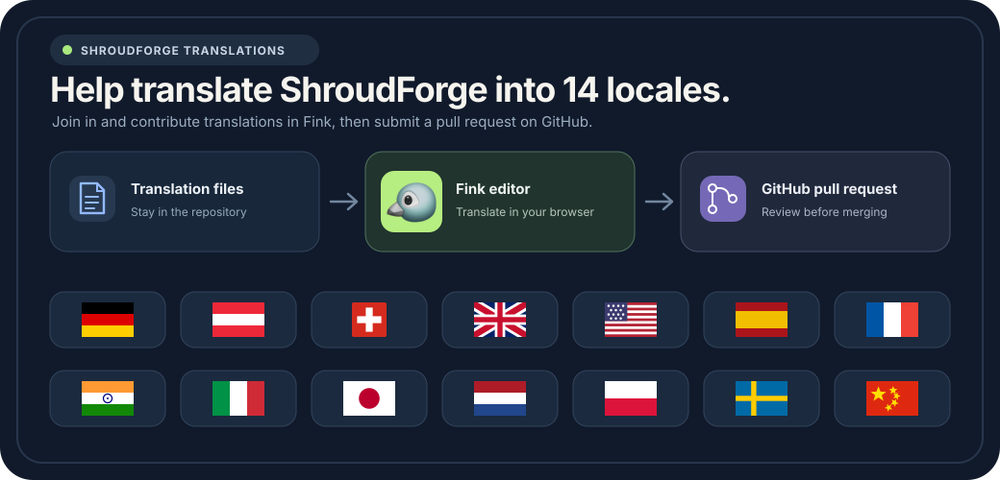

# Übersetzungen für den Modloader

Hilf mit, ShroudForge für Spieler weltweit verfügbar zu machen. Bearbeite Übersetzungen in Fink oder reiche deine Änderungen als Pull Request im GitHub-Repository ein.

[](https://fink.inlang.com/?repo=bonsaibauer/shroudforge&project=modules/ui-resources/project.inlang)

## Mit Fink übersetzen

Öffne den [Fink-Editor für ShroudForge](https://fink.inlang.com/?repo=bonsaibauer/shroudforge&project=modules/ui-resources/project.inlang). Fink zeigt den englischen Ausgangstext und die Übersetzungen nebeneinander. Die Sprachdateien bleiben im Repository. Fink synchronisiert keine zweite Kopie in einem Übersetzungsdienst.

Wähle im Editor das Projekt und den Branch aus. Prüfe die Meldung, ändere die Übersetzung und kontrolliere die Vorschau. Fink speichert deine Arbeit zunächst als lokalen Entwurf im Browser. Zum Speichern auf GitHub brauchst du ein GitHub-Konto.

## Änderungen als Pull Request einreichen

Wenn der Hauptbranch geschützt ist, lege zuerst in GitHub einen Übersetzungsbranch an. Öffne diesen Branch in Fink und übertrage deine Änderungen dorthin. Danach kannst du einen Pull Request erstellen und ihn vor dem Zusammenführen prüfen lassen. Fink legt den Branch nicht selbst an.

Ohne Schreibzugriff auf das ShroudForge-Repository kannst du in Fink einen Fork verwenden. Installiere dazu die Inlang-GitHub-App auf deinem Konto, übertrage die Änderungen in deinen Fork und öffne anschließend den Pull Request. Fink öffnet die GitHub-Seite für den Pull Request. Du musst ihn dort noch prüfen und absenden.

Die [Pull Requests im ShroudForge-Repository](https://github.com/bonsaibauer/shroudforge/pulls) zeigen offene Übersetzungsbeiträge und ihren Prüfstatus. Weitere Details stehen in der [Fink-Anleitung zu Branches und Pull Requests](https://fink.inlang.com/docs/branches-forks-and-pull-requests).

## Übersetzungsdateien direkt bearbeiten

Du kannst auch die JSON-Dateien unter `modules/ui-resources/locales/` ändern und einen Pull Request im Repository erstellen. Verwende für jede Sprache dieselben Schlüssel wie in der englischen Quelldatei `en-GB.json`. Ändere keine Platzhalternamen wie `{count}`. Sie müssen in jeder Übersetzung exakt erhalten bleiben.

Vor dem Pull Request kannst du die Locale-Dateien prüfen:

```powershell
cd modules/modloader/ui
npm run locale:check
```

Die Fink-Projektdatei `modules/ui-resources/project.inlang/settings.json` verbindet den Editor mit diesen Katalogen. Der Beispiel-Link oben öffnet dieses Projekt. Wenn später ein anderer Editor-Link verwendet wird, ändere die URL im Link dieses Artikels und im SVG-Bild.
