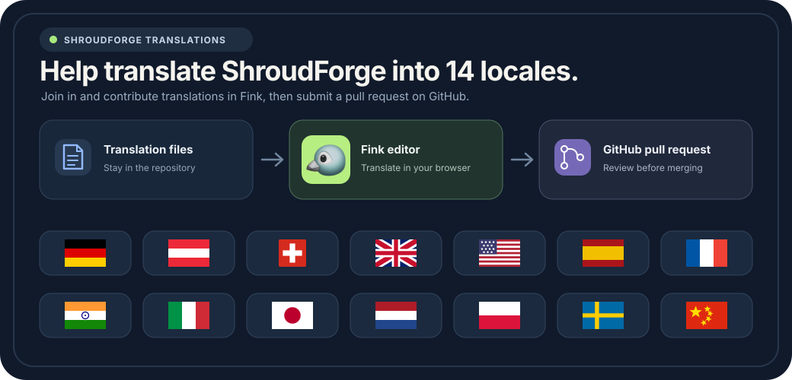

# Translate the Modloader

Help make ShroudForge available to players worldwide. Edit translations in Fink or submit your changes as a pull request on GitHub.

[](https://fink.inlang.com/?repo=bonsaibauer/shroudforge&project=modules/ui-resources/project.inlang)

## Translate with Fink

Open the [Fink editor for ShroudForge](https://fink.inlang.com/?repo=bonsaibauer/shroudforge&project=modules/ui-resources/project.inlang). Fink shows the English source text beside its translations. The language files stay in the repository. Fink does not keep a second synced copy in a translation service.

Choose the project and branch in the editor. Review a message, edit its translation and check the result. Fink first saves your work as a draft in your browser. You need a GitHub account to save changes to GitHub.

## Send changes as a pull request

If the default branch is protected, create a translation branch on GitHub first. Open that branch in Fink and push your changes there. Then create a pull request so the changes can be reviewed before they are merged. Fink does not create branches for you.

If you cannot write to the ShroudForge repository, use Fink's fork flow. Install the Inlang GitHub App on your account, push the changes to your fork, then open a pull request. Fink opens GitHub's pull request page. Review and submit the pull request there.

The [ShroudForge pull request list](https://github.com/bonsaibauer/shroudforge/pulls) shows open translation contributions and their review status. See the [Fink guide to branches and pull requests](https://fink.inlang.com/docs/branches-forks-and-pull-requests) for more details.

## Edit the translation files directly

You can also change the JSON files under `modules/ui-resources/locales/` and create a pull request in the repository. Keep the same keys as the English source file `en-GB.json`. Do not rename placeholders such as `{count}`. Their names must stay exactly the same in each translation.

Before opening a pull request, you can check the locale files:

```powershell
cd modules/modloader/ui
npm run locale:check
```

The Fink project file `modules/ui-resources/project.inlang/settings.json` connects the editor to these catalogs. The example link above opens that project. If you use a different editor URL later, update it in this article link and in the SVG illustration.
